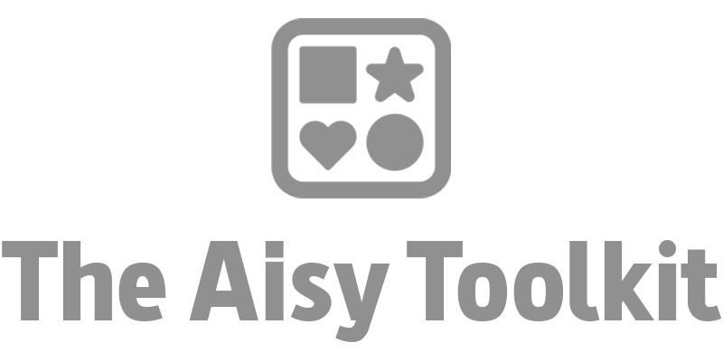
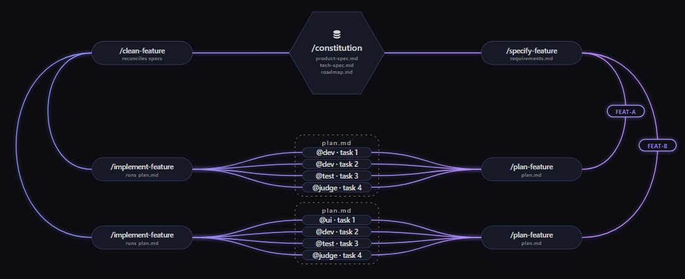

<p align="center">
  <picture>
    <source media="(prefers-color-scheme: dark)" srcset="assets/logo-dark.png">
    <source media="(prefers-color-scheme: light)" srcset="assets/logo-light.png">
    
  </picture>
</p>

<p align="center">
  <strong>Go from vibe coding to Spec-Driven Development. Orchestrate agentic loops with a copy-paste catalog of skills and subagents, no install required.</strong>
</p>

<p align="center">
  
</p>

<p align="center">
  
  
  
  
</p>

<p align="center">
  🌐 <strong>English</strong> · <a href="README-ES.md">Español</a>
</p>

<p align="center">
  
</p>

<p align="center">
  My AIsy Toolkit brings together skills and subagents ready to install in your repo, so you can start building with Spec-Driven Development and agentic loops, compatible with Claude Code and Codex CLI in best-effort mode. Point your agent at one URL (or paste one file), and any repo gets the same catalog of commands and subagents, ready to use, no libraries, no package managers, nothing to install globally.
</p>

---

## ⚡ Quick Setup

From inside the repo you want to set up, paste this into your agent's conversation:

```
Fetch and follow the setup instructions at https://raw.githubusercontent.com/charlstown/my-aisy-toolkit/main/setup-ai.md
```

Your agent fetches the plain-text instructions, follows them, and gives you a final report. There is nothing to download, no package manager, and no executable installer: the agent copies the catalog's literal files. `catalog.yaml` stays a single literal manifest at the repository root.

`aisy.setup-ai` makes exactly three decisions: target (Claude Code, Codex CLI, or explicit `both`), displayed profile, and one opt-in authorization for a global launcher after local installation. It automatically adds `packs.utils`; it never asks a fourth utils question. A single-target run never touches the other target, and `both` is never inferred from folders.

New skills use `aisy.<name>` and historical unprefixed folders are not migrated, renamed, or deleted. See the [detailed catalog](ai-toolkit/README.md) before installing.

---

### Terminal setup

Prefer the terminal? Pass it straight as the prompt when you start the agent:

```
claude "Fetch and follow the setup instructions at https://raw.githubusercontent.com/charlstown/my-aisy-toolkit/main/setup-ai.md"
```

```
codex "Fetch and follow the setup instructions at https://raw.githubusercontent.com/charlstown/my-aisy-toolkit/main/setup-ai.md"
```

## 📦 What will you find here?

- **15 skills** in total: 10 covering the full spec-driven workflow (`default` profile), +2 for a dedicated UI/UX pass (`ui-ux` profile), +3 standalone ones (`utils` pack)
- **6 subagents** for architecture, implementation, testing, UI, and review
- **2 catalog profiles**: `default` and `ui-ux` (adds `/aisy.ui-spec` and `/aisy.clarify-uix`)
- **1 automatic skill pack**: `utils` (`/aisy.digest`, `/aisy.grill-me`, `/aisy.for-dummies`), installed with either profile
- **1 install method**: one URL or one pasted file, nothing to download
- **2 AI coding agents** supported: Claude Code and Codex CLI, each with its native agent artifacts

And the catalog keeps growing as new skills and agents are added.

## 🔁 How it works

Point your agent at the setup URL once — that's the only install step. `/aisy.constitution` bootstraps the specs (product-spec, tech-spec, roadmap), then every feature goes through the same closed loop: `/aisy.specify-feature` scopes it, `/aisy.clarify-feature` closes any decision gaps, `/aisy.plan-feature` breaks it down, `/aisy.implement-feature` builds it, and `/aisy.clean-feature` closes the loop by aligning the specs again before the next feature starts.

<p align="center">
  
</p>

## 📚 Catalog: default profile

**Skills**

| Skill | What it does |
|-------|----------|
| `/aisy.constitution` | Kicks off product-spec and tech-spec in sequence to bootstrap a project's root specs. |
| `/aisy.product-spec` | Generates or updates `specs/product-spec.md` by interviewing the user. |
| `/aisy.tech-spec` | Generates or updates `specs/tech-spec.md` (the technical how) from the product-spec. |
| `/aisy.roadmap` | Generates `specs/roadmap.md` from the product-spec and tech-spec. |
| `/aisy.new-issue` | Opens a bug or feature issue on GitHub, investigating or clarifying depending on type. |
| `/aisy.specify-feature` | Detects features from various sources (including open GitHub issues) and scaffolds a `requirements.md` per feature. |
| `/aisy.clarify-feature` | Closes the pending decision gaps in one or more `requirements.md` files. |
| `/aisy.plan-feature` | Generates `plan.md` from a `requirements.md`, attributing tasks to subagents. |
| `/aisy.implement-feature` | Orchestrates the execution of one or more `plan.md` files using git worktrees. |
| `/aisy.clean-feature` | Aligns the root specs with completed work and closes the associated issue. |

**Agents** (Claude Code subagents)

| Agent | Role |
|--------|-----|
| `architect` | Discovery, evaluation of alternatives, and solution design before implementing. |
| `code-developer` | Implements application code from an already-defined plan. |
| `test-developer` | Writes tests (does not run them). |
| `tester` | Runs tests and verifies the application's real behavior. |
| `ui-developer` | Designs and implements complete screens (HTML/CSS/TS/React). |
| `judge` | Reviews other agents' work and issues a PASS / CHANGES_REQUESTED verdict. |

> [!note] Codex CLI
> Skills are shared and copied literally to `.agents/skills/`; Codex agents are installed from native `.toml` artifacts in `.codex/agents/`.

## 🎨 Catalog: `ui-ux` profile

Everything in `default`, plus two skills for a dedicated UI/UX pass (12 skills total, same 6 agents):

| Skill | What it does |
|-------|----------|
| `/aisy.ui-spec` | Interviews top-down (content structure → layout → interaction/states → devices/accessibility) to design a UI screen, with concept mockups and a self-critique pass, and writes `specs/ui-spec.md`. |
| `/aisy.clarify-uix` | The UI/UX counterpart to `/aisy.clarify-feature`: runs a top-down round of UI/UX questions (4, 8, or 12) and folds the answers into `requirements.md`. |

## 🧰 Automatic pack: `utils`

Standalone skills that don't belong to any profile. Every `packs.utils` entry is installed automatically with `default` or `ui-ux`:

| Skill | What it does |
|-------|----------|
| `/aisy.digest` | Turns a vague doubt into a short interrogation, a brief web research pass, and a recommendation with an alternative. |
| `/aisy.grill-me` | Critically interrogates a document to close gaps and inconsistencies, then rewrites it with what it learned. |
| `/aisy.for-dummies` | Explains one or more concepts from a prompt, link, or document like an expert teacher, with examples and optional resources. |

## 🗂️ Project structure

Just the pieces that matter to a reader deciding whether to install:

```
my-aisy-toolkit/
├── ai-toolkit/
│   ├── skills/          # shared, literal SKILL.md sources
│   └── agents/          # native Claude Markdown and Codex TOML
├── catalog.yaml
├── setup-ai.md
└── README.md
```

## 📝 Good to know

**Re-installing or updating.** Re-running setup brings the latest catalog and updates only selected `aisy.` destinations whose literal bytes changed. It does not migrate, rename, or delete historical unprefixed installations.

**Local destinations and launcher**

| Target | Local skills | Native agents | Optional global launcher |
|-------|--------------|---------------|--------------------------|
| Claude Code | `.claude/skills/aisy.<name>/SKILL.md` | `.claude/agents/<name>.md` | `~/.claude/commands/aisy.setup-ai.md` → `/aisy.setup-ai` |
| Codex CLI | `.agents/skills/aisy.<name>/SKILL.md` | `.codex/agents/<name>.toml` | `~/.codex/skills/aisy.setup-ai/SKILL.md` → `$aisy.setup-ai`; fallback to `~/.agents/skills/aisy.setup-ai/SKILL.md` only when `.codex/` is absent and `.agents/` exists |

The global launcher is offered only once, after local installation, and only for the selected target (for explicit `both`, once for both selected destinations). A missing global root is reported and never created. Launchers do not fetch `setup-ai.md` or self-update.

The final report names created and updated paths, counts unchanged artifacts, details failures, and separately states the automatic utils, confirmed target and profile, launcher result, download method, and any discovery limitation. Application code is left alone.

## 🤝 Code of Conduct

This project follows a [Code of Conduct](CODE_OF_CONDUCT.md). By participating, you're expected to uphold it.
