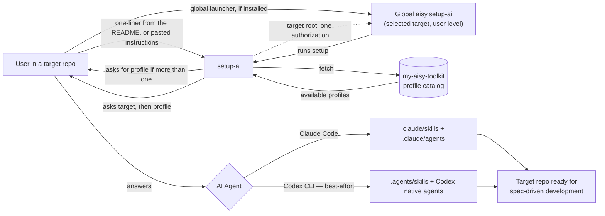

> [!abstract] Metadata
> | | |
> |---|---|
> | **Status** | 🟡 Draft |
> | **Owner** | Carlos |
> | **Created** | 2026-08-01 |
> | **Updated** | 2026-08-09 |
> | **Version** | v0.1 |

## 🎯 Vision

> **Current catalog architecture.** Distributable skills have one shared source at `ai-toolkit/skills/<name>/SKILL.md`. Claude and Codex install that same file literally into their respective skill destinations. Their agents are native, separate artifacts under `ai-toolkit/agents/claude/` and `ai-toolkit/agents/codex/`; `catalog.yaml` declares every installed path explicitly. This architecture supersedes earlier descriptions of runtime translation.

**My AIsy Toolkit** is a distributable kit of skills and subagents for spec-driven development with AI coding agents (Claude Code, and in best-effort mode Codex CLI), installable in any repository with a one-liner or by pasting plain text — no libraries, no package managers, no friction.

## 🔥 Problem Statement

| Pain | Root Cause |
|------|-----------|
| Reproducing the same set of skills/agents in every new repo means copying `.claude/` folders by hand | There is no centralized distribution mechanism; every repo keeps its own copy, which drifts out of sync over time |
| Spec-driven development flows (product-spec, tech-spec, roadmap, plan-feature, implement-feature...) get reinvented project by project | There is no standard, versioned, reusable catalog in a single place |
| Installing AI tooling in a repo usually drags in dependencies, package managers, and configuration | Existing solutions (plugins, npm packages, marketplaces) add friction and failure surface |
| Every AI coding agent (Claude Code, Codex CLI...) expects its skills and agents in different native locations and formats | There is no installation layer that copies a shared skills source and native agent artifacts to each agent's destinations |

## 👤 Target User

- 🎯 **Primary** — Carlos, owner of the multi-repo vault: needs to replicate his set of Claude Code skills/agents in any new repo without copying folders by hand or maintaining different versions in each place.
- 👥 **Secondary** — Devs using Claude Code (and, in best-effort mode, Codex CLI) who want to adopt spec-driven development with AI agents without designing their own skills from scratch.
- 🌍 **Stretch** — Teams starting a new repository who want a standard starting point (specs, roadmap, agents) instead of improvising their own flow.

## 💎 Design Principles

- **Zero dependencies / zero friction** — installation via a one-liner fetch or by pasting plain text into any agent. No package manager, no library, and no global write unless the user authorizes the optional `aisy.setup-ai` launcher for the selected target in a single confirmation.
- **README as product** — the README is the kit's "front": it must convince and allow installing in under 2 minutes. It is treated as the main piece, not an afterthought.
- **Extensible profiles from day one** — the catalog now ships two profiles, `default` and `ui-ux` (a superset of `default`'s catalog plus the `ui-spec` and `clarify-uix` skills), and the installation mechanism detects and asks about available profiles without needing a redesign when more are added.
- **Multi-agent by shared skills and native agents** — every supported agent receives the same literal skill source at its native skills path, while its agents remain native artifacts (`.md` for Claude Code and `.toml` for Codex), without runtime translation.
- **Deliberately vendor-agnostic delivery** — the kit is distributed as plain-text instructions fetched over plain HTTPS, never published to a single vendor's proprietary channel (e.g. the Claude Code plugin/marketplace system, see ADR-007 in tech-spec.md). This is a conscious tradeoff, not an oversight: it keeps the same one-liner/copy-paste mechanism usable by any AI agent capable of fetching and following instructions, so support can extend to more providers over time (today Claude Code and Codex CLI) without being tied to, or gated by, any one agent's ecosystem.
- **Direct, jargon-free tone** — installer messages, README, and skill names are clear, short, and have a light, easygoing touch ("Keep it AIsy"), never sounding corporate.
- **Always the latest version** — no semantic versioning or release tags for *catalog distribution*: installing or re-installing always brings the current state of the catalog's main branch, with no version selection for the end user. (The repo itself is versioned via git tags `vX.Y.Z` only — there is no `VERSION` file — computed and pushed automatically on merge to `main` from the PR title's prefix (`release:`/`feature:`/`fix:`/`chore:`, per CLAUDE.md); see ADR-006 in tech-spec.md. That versioning is decoupled from, and does not affect, how the catalog gets installed.) A launcher is updated only by an explicit reinstall or update of `setup-ai`, never by self-update at invocation time.

## 🏗️ Architecture



- **User** — starts the installation from the repo where they want the kit, by one of two routes: the one-liner from the README, or a previously installed `/aisy.setup-ai` or `$aisy.setup-ai` launcher. Selects a target and a displayed profile. Does not interact directly with the `my-aisy-toolkit` repo.
- **setup-ai** — plain-text entry point that asks for one target (Claude or Codex; `both` only when explicitly requested), fetches `/catalog.yaml`, validates `profiles` and the artifacts declared for the selected target, then displays every profile and its skills and asks for a valid profile. It installs the profile and all `packs.utils` entries locally without another question. It uses the native question capability when available and otherwise waits for a conversational answer. Skills are copied literally to `aisy.<name>` destinations; agents remain native. Both entry routes execute this same flow.
- **Global launcher** — optional user-level `aisy.setup-ai` shortcut for the selected target only. At the end of the local installation, Step 6 checks only that target's existing root, asks once, and copies its literal template idempotently. It never creates a missing root, reads or writes the other agent's root, self-updates, or treats unavailable discovery as a failed installation.
- **my-aisy-toolkit (catalog)** — single source of truth: shared skills under `/ai-toolkit/skills/<name>/SKILL.md`, separate native agents under `/ai-toolkit/agents/claude/*.md` and `/ai-toolkit/agents/codex/*.toml`, and the literal root manifest `/catalog.yaml`. It does not execute itself; it only serves content for `setup-ai` to consume. This is decoupled from the repo's own internal `.claude/` folder, which is used only to develop this toolkit itself (dogfooding) and is never what gets installed into a target repo.
- **Target repo** — receives the installed files and becomes operational for spec-driven development through the corresponding AI agent's skills. Each skill/agent's internal logic lives in its own self-documented file.

## 🛠️ Interfaces

### Installation

#### One-liner (fetch of `setup-ai`)

Single command the user pastes into their terminal (or asks their agent to run) inside the target repo.

| Param | Type | Default | Description |
|-------|------|---------|--------------|
| `profile` | string | asked | `setup-ai` displays every numbered profile and its skills, then requires a valid selection. |
| `agent` | string | asked | Target AI agent (`claude`, `codex`, or `both` only when explicitly requested). It is never inferred from target-repo folders. |

> [!warning] Side effect
> Writes only to the selected target's local skill and native-agent directories. It does not touch application code or the other target. All selected profile skills and every `packs.utils` entry are installed automatically as `aisy.<name>` skills. **One opt-in exception:** after local installation, `setup-ai` may save `aisy.setup-ai` under the selected target's existing user-level root after one explicit yes. Historical installations without the `aisy.` prefix are neither migrated, renamed, nor deleted.

#### Copy-paste (plain instructions)

Plain-text block the user pastes directly into the conversation of any AI coding agent, without running any script. The agent interprets the instructions and performs the installation itself (reads the catalog, writes the files).

| Param | Type | Default | Description |
|-------|------|---------|--------------|
| `agent` | string | asked | Same explicit target selection as the one-liner. |
| `profile` | string | asked | The agent displays every numbered profile with its included skills, then asks for a valid selection. |

#### Global launcher (`aisy.setup-ai`)

Step 6 runs after local installation. It considers only the selected target (or each target when `both` was explicitly selected), reports its expected global path, and asks once for authorization. A missing target root is reported and never created. After an explicit yes, the literal template already retained from the bootstrap is copied idempotently; the launcher never downloads `setup-ai.md` to self-update.

| Agent | Where it's saved | How it's invoked |
|-------|------------------|------------------|
| Claude Code | `~/.claude/commands/aisy.setup-ai.md` | `/aisy.setup-ai` |
| Codex CLI — best-effort | `~/.codex/skills/aisy.setup-ai/SKILL.md`; fallback `~/.agents/skills/aisy.setup-ai/SKILL.md` only when `.codex/` is absent and `.agents/` exists | `$aisy.setup-ai` — a `$` skill, not a slash command |

> The Codex row is best-effort like the rest of Codex support. Its canonical global root is `~/.codex/`; `$aisy.setup-ai` is never a slash command.

How it gets there:

- **One explicit authorization for the selected target.** A no, silence, or ambiguous answer is treated as no and never changes the completed local installation.
- **Target-scoped operation.** Selecting Claude never accesses Codex paths and selecting Codex never accesses Claude paths. `both` is permitted only as an explicit target choice; it is never inferred or an all-or-nothing side effect.
- **Idempotent copy and structural verification.** Existing launchers are written only when literal bytes differ. Path, bytes, transient SHA-256 and native frontmatter determine success; discovery is attempted only when the active session exposes it, otherwise the limitation is reported.

> [!warning] Side effect
> This launcher is the only file the kit writes outside the target repo, and only after an explicit yes for an existing root of the selected target.

#### Operating contract

Every run has exactly three decision moments: target, displayed profile, and optional global-launcher authorization. The target governs all local and global reads and writes; `both` is an explicit request, never a default side effect. Downloads use only the exact declared HTTPS URLs, selecting and remembering the most stable compatible direct method for the run. Artifact bytes and SHA-256 comparisons are transient; `/catalog.yaml` remains a simple literal manifest. Per-artifact failures do not stop independent artifacts, and the final report lists created and updated paths, counts unchanged paths, details failures, and separately reports automatic utils, the launcher, the download method, and discovery limitations.

#### Re-installation / update

Running any of the methods above on a repo that already has the kit installed. It always brings the latest catalog (no semantic versioning), adds newly declared profile artifacts and automatic utils, and updates the selected `aisy.` destinations only when literal bytes differ. It never migrates, renames, or deletes a historical installation without the `aisy.` prefix.

### Catalog — profiles

#### `default` profile

**Skills**

| Skill | What it does |
|-------|----------|
| `/aisy.constitution` | Kicks off product-spec, tech-spec, and roadmap in sequence to bootstrap a project's root specs. |
| `/aisy.product-spec` | Generates or updates `specs/product-spec.md` by interviewing the user. |
| `/aisy.tech-spec` | Generates or updates `specs/tech-spec.md` (the technical how) from the product-spec. |
| `/aisy.roadmap` | Generates `specs/roadmap.md` from the product-spec and tech-spec. |
| `/aisy.new-issue` | Opens a bug or feature issue on GitHub, investigating or clarifying depending on type. |
| `/aisy.specify-feature` | Detects features from various sources (including open GitHub issues) and scaffolds a `requirements.md` per feature. |
| `/aisy.clarify-feature` | Closes the pending decision gaps in one or more `requirements.md` files. |
| `/aisy.plan-feature` | Generates `plan.md` from a `requirements.md`, attributing tasks to subagents. |
| `/aisy.implement-feature` | Orchestrates the execution of one or more `plan.md` files using git worktrees. |
| `/aisy.clean-feature` | Aligns the root specs with completed work and closes the associated issue. |

**Agents (Claude Code subagents)**

| Agent | Role |
|--------|-----|
| `architect` | Discovery, evaluation of alternatives, and solution design before implementing. |
| `code-developer` | Implements application code from an already-defined plan. |
| `test-developer` | Writes tests (does not run them). |
| `tester` | Runs tests and verifies the application's real behavior. |
| `ui-developer` | Designs and implements complete screens (HTML/CSS/TS/React). |
| `judge` | Reviews other agents' work and issues a PASS / CHANGES_REQUESTED verdict. |

> Codex CLI receives the same skills copied literally to `.agents/skills/aisy.<name>/SKILL.md` and its native agent artifacts from `ai-toolkit/agents/codex/*.toml`; Claude Code receives literal skills in `.claude/skills/aisy.<name>/SKILL.md` and `ai-toolkit/agents/claude/*.md` in its native agents location.

#### `ui-ux` profile

Superset of `default`'s 10 skills and 6 agents, plus:

| Skill | What it does |
|-------|----------|
| `/aisy.ui-spec` | Interviews the user top-down about a UI screen (content structure → layout → interaction/states → devices/accessibility) and writes/updates `specs/ui-spec.md` in the target repo. |
| `/aisy.clarify-uix` | UI/UX counterpart to `/aisy.clarify-feature`; lets the user pick 4/8/12 questions (one marked "recommended") before running the interrogation in the same staged style as `/aisy.ui-spec`. |

Agents: identical to `default`'s 6 agents — no new agent introduced.

Across shared skills, Claude Code preserves each skill's own questioning flow. In Codex, when `ask_user_question` is unavailable, the conversational fallback presents exactly one pending question at a time, using multiple-choice or sequential alternatives with visible indexes and an explicit invitation to answer by index or with free text; it processes the answer before asking another question, records unresolved free-text decisions as gaps, and continues only independent work. When applicable, prompts use the language of the user's latest message.

### Catalog — Utils pack (automatic)

`packs.utils` is a non-profile group of skills, independent of the chosen profile. When the catalog declares it, every entry is added automatically to the selected target's local plan; it does not introduce a fourth decision. Its literal shared files use `aisy.<skill>` at `.claude/skills/aisy.<skill>/SKILL.md` or `.agents/skills/aisy.<skill>/SKILL.md` to avoid collisions with the user's own skills.

| Skill | What it does |
|-------|----------|
| `digest` | From a vague user prompt (a doubt, a fear, or a reflection), runs a short interrogation (max 3 questions) to narrow down what and how to research, does brief internet research on trends, articles, or documents related to the topic, and always closes with at least 1 recommendation and 1 alternative (option B), justifying the reasoning behind the recommended decision. |
| `grill-me` | Critical interrogation of a document to reduce gaps, clarify decisions, and detect inconsistencies. When finished, rewrites the document with everything learned. Requires an input document. |
| `for-dummies` | Explains one or more concepts from a vague prompt, link, or document like an expert teacher, with examples and up to 3 optional free resources per concept. |

## 🩺 Operations

**Healthcheck**

Verifying the repository installation means checking the selected target's expected `aisy.<name>` skills and native agents against their literal sources. Downloaded bytes are verified with a transient SHA-256 after copy; no integrity metadata is persisted in `catalog.yaml`. Temporary staging, if needed, is limited to `.claude/.aisy-setup-tmp/` or `.agents/.aisy-setup-tmp/` for the confirmed target and removed at completion. For an authorized global launcher, path, bytes, transient SHA-256 and frontmatter are sufficient; discovery is checked only when available and otherwise reported as a limitation.

**Logging**

`setup-ai` does not generate persistent logs. Its final conversational report lists created and updated paths, counts unchanged artifacts without listing them, and details every failure and cause. It separately identifies automatic utils, the global launcher result, the download method, and any unavailable discovery check.

## 📦 Deliverables

| Deliverable | Description |
|:-----------:|-------------|
| 💻 **Catalog (source code)** | Shared skills at `/ai-toolkit/skills/<name>/SKILL.md`, copied literally to `aisy.<name>` destinations; native agents at `/ai-toolkit/agents/claude/*.md` and `/ai-toolkit/agents/codex/*.toml`; root `/catalog.yaml` declares profile membership and every literal source path, without persistent hashes or integrity metadata. Utils use the same shared-skill structure and are installed automatically. |
| 🛠️ **setup-ai** | Installation instructions/script: one-liner method and copy-paste method. |
| 📚 **README** | Presents the kit, installation instructions (both methods), the `default` profile catalog, and a quick usage guide. |

## 🗂️ Project Structure

> [!abstract]- File tree
> ```
> my-aisy-toolkit/
> ├── .claude/             # Internal only: this repo's own Claude Code setup, used to develop the toolkit itself (not distributed)
> │   ├── commands/
> │   └── agents/
> ├── ai-toolkit/
> │   ├── skills/          # One shared source per skill
> │   │   └── <name>/SKILL.md
> │   ├── agents/
> │   │   ├── claude/      # Native Claude Code agent (*.md)
> │   │   └── codex/       # Native Codex agent (*.toml)
> ├── catalog.yaml          # Root manifest: profile membership and literal sources
> ├── specs/               # product-spec.md, tech-spec.md, roadmap.md for this repo itself
> ├── setup-ai.md          # Plain-text installation instructions (root)
> └── README.md            # Project front: installation, catalog, usage
> ```

## 🚫 Out of Scope

- **Exhaustive documentation of each skill/agent's internal behavior** — this ProductSpec lists the catalog, but each skill's detailed behavior lives in its own self-documented file.
- **Support for AI agents other than Claude Code and Codex CLI** (Devin, Cursor, Windsurf, etc.) — a conscious decision by the user; a possible future extension.
- **Granular version management or rollback per individual skill** — the installer always brings the latest version of the full profile; there is no selective install or reverting to previous versions.
- **Additional profiles beyond `default` and `ui-ux`** — the mechanism must support them, but their concrete content is not defined in this ProductSpec.

## 🔮 Future

- **Additional profiles** — profiles beyond `default` and `ui-ux` (e.g. `minimal`, `frontend-only`) for different project types or team preferences.
- **Verified Codex CLI support** — move from best-effort to tested support in a real Codex environment.
- **Support for other AI agents** — evaluate Devin, Cursor, Windsurf or others under the same adaptation layer.
- **Catalog version notifications** — notify when the target repo has an outdated version of the installed catalog.

## ❓ Discovery

- [x] ~~Is Codex CLI supported in v1?~~ → Yes, in best-effort mode: shared skills are copied literally to `.agents/skills/` and Codex agents use native `.toml` artifacts, documented as unverified in a real environment until it can be tested.
- [x] ~~How is the catalog versioned?~~ → Catalog *distribution* always brings the latest of the main branch; no semantic versioning or version selection there. Separately, the repo itself is now SemVer-tagged automatically: merging a PR to `main` computes and pushes the next `vX.Y.Z` git tag from the PR title prefix (`release:`/`feature:`/`fix:`/`chore:`, enforced by a required precheck — see CLAUDE.md and ADR-006 in tech-spec.md); there is no `VERSION` file, the git tag is the sole source of truth. The two are independent: bumping the repo version never changes what `setup-ai` installs.
- [x] ~~Tone for user-facing content?~~ → Direct, jargon-free, with a light easygoing touch ("Keep it AIsy").
- [x] ~~Exact location of the `setup-ai` script/instructions within the repo?~~ → Repo root (`setup-ai.md`), per tech-spec.md.
- [x] ~~Concrete mechanism for target, profile, and global-launcher authorization?~~ → ADR-004: the target is always asked explicitly (never inferred/detected from folders present); after validating the catalog, every displayed profile is shown and a valid profile is selected; the third decision is optional authorization for the target-scoped global launcher.
