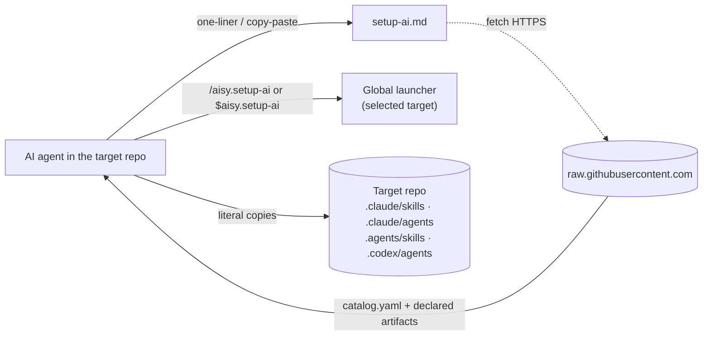
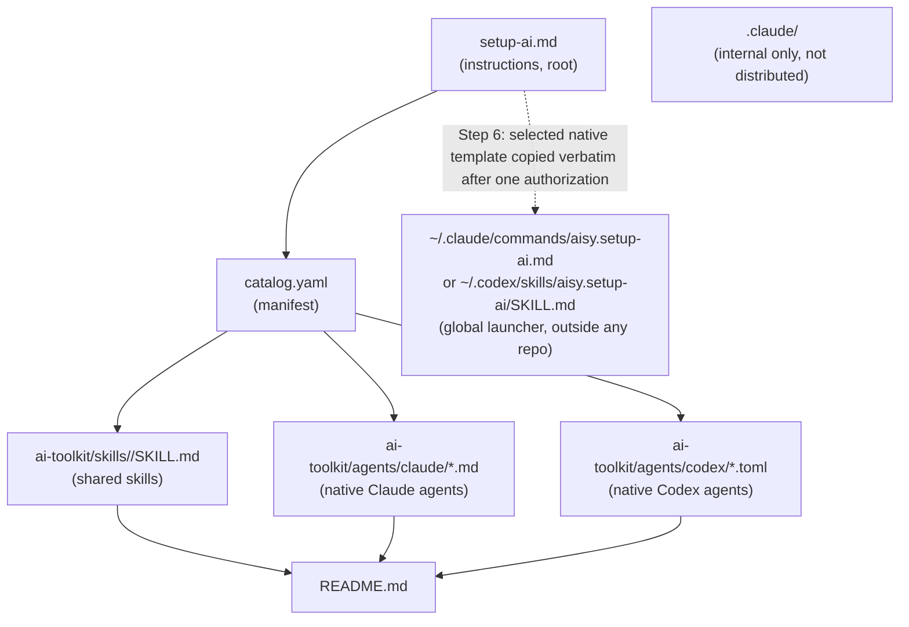
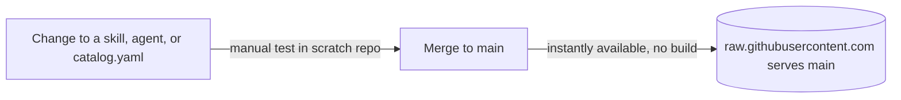

> [!abstract] Metadata
> | | |
> |---|---|
> | **Status** | 🟡 Draft |
> | **Owner** | Carlos |
> | **Created** | 2026-08-01 |
> | **Updated** | 2026-08-08 |
> | **Version** | v0.1 |
> | **ProductSpec** | [[product-spec]] |

## 📌 Scope

> **Current catalog architecture.** `ai-toolkit/skills/<name>/SKILL.md` is the sole distributable skill source and is copied byte-for-byte. Native agents are stored independently at `ai-toolkit/agents/claude/*.md` and `ai-toolkit/agents/codex/*.toml`; root `/catalog.yaml` supplies all literal source paths. Any older passage below that describes command-folder distribution or runtime translation is historical context superseded by ADR-002.

This document covers the technical installation mechanism (`setup-ai`) and the catalog format (skills and agents, currently spanning the `default` and `ui-ux` profiles, plus optional non-profile packs such as `utils`) for Claude Code and, in best-effort mode, Codex CLI. The product's what and why are already defined in [[product-spec]]; this document only answers the how.

## 🧱 Tech Stack

| Component | Technology | Version | Rationale |
|-----------|------------|---------|-----------|
| Installer | Plain-text instructions (Markdown), interpreted and executed by the target AI agent with its own tools | — | Zero dependencies: no bash, Node, or any runtime required; portable across operating systems and agents |
| Catalog manifest | YAML (`catalog.yaml`) | — | Human-readable and easy for an LLM to parse; follows the same pattern as `reference.yaml` in the reference repo (FlorianBruniaux/claude-code-ultimate-guide) |
| Shared skills | `ai-toolkit/skills/<name>/SKILL.md` | — | One distributable artifact, copied literally to the selected platform's skills directory; no translation |
| Agents — Claude Code | Markdown (`ai-toolkit/agents/claude/*.md`) | — | Native Claude agent artifacts, copied literally to `.claude/agents/` |
| Agents — Codex | TOML (`ai-toolkit/agents/codex/*.toml`) | — | Native Codex agent artifacts, copied literally to `.codex/agents/` |
| File transport | Direct HTTPS to `raw.githubusercontent.com` | — | The agent evaluates compatible direct methods once, reuses the most stable byte-preserving method, and never substitutes search, cache, listing, or another URL |

> [!tip] No runtime dependencies
> There are no npm packages, gems, or binaries to install. The whole mechanism relies on the native fetch, read, and write tools of the AI agent running `setup-ai`.

> [!tip] Internal vs. distributed catalog
> This repo's own local configuration is not a distribution source. The distributable catalog is explicit: shared skills live only in `ai-toolkit/skills/<name>/SKILL.md`, while native agents live in their platform-specific directories. `catalog.yaml` declares every source path literally; no profile-folder convention, remote directory listing, or runtime conversion determines installed content.

## 🏗️ Module Design



The copy-paste route follows `setup-ai.md`. Step 6 optionally installs the native `aisy.setup-ai` launcher only for the selected target after one explicit authorization; `both` is processed only when it was selected explicitly. Its sole purpose is to make the same maintenance workflow available from another repository.



#### `setup-ai.md` — Installation instructions

Natural-language guide an AI agent follows step by step. It asks for the target, fetches root `/catalog.yaml` using the retained stable direct-download method, shows every profile with its skills, then asks for the profile. It adds all declared utils automatically, constructs a literal in-memory artifact plan, and copies each artifact to the selected target-native `aisy.<name>` destination. Its Step 6 contains the literal native launcher templates and the target-specific authorization contract.

#### Global launcher — user-level command

User-level shortcut, written outside any repo so the user can run `aisy.setup-ai` from anywhere to update or reinstall skills. Step 6 targets only the selected agent; it is neither a local-repository launcher nor a self-updating template mechanism.

| Target agent | Path | Format | Invoked as |
|---|---|---|---|
| Claude Code | `~/.claude/commands/aisy.setup-ai.md`, when `~/.claude/` exists | Markdown + frontmatter (`description`, `argument-hint`), same shape as any user-level slash command | `/aisy.setup-ai` |
| Codex CLI | `~/.codex/skills/aisy.setup-ai/SKILL.md`, or `~/.agents/skills/aisy.setup-ai/SKILL.md` only when `.codex/` is absent and `.agents/` exists | Folder with `SKILL.md` + frontmatter (`name`, `description`) | `$aisy.setup-ai` |

Before writing, Step 6 shows the selected target's exact destination and requests one authorization only. It checks only that target's root; a missing root is reported and never created. It copies the corresponding template from the already retained bootstrap byte-for-byte, treating identical content as unchanged, and verifies exact path, bytes, transient SHA-256 and recognizable native frontmatter afterwards. If a runtime discovery check is available, it is attempted; otherwise the limitation is reported rather than claiming executable discoverability. Catalog artifacts and launcher templates are copied literally, never translated. No historical destination without the `aisy.` prefix is migrated, renamed, or removed.

#### `catalog.yaml` — Catalog manifest

Single root index declaring, for each profile and optional pack, the included skills and native agents plus each artifact's explicit source path in this repository.

#### `ai-toolkit/skills/` — Shared skill catalog

Distributable source of truth for all shared skills. Each skill is a single `ai-toolkit/skills/<name>/SKILL.md` artifact referenced explicitly by root `/catalog.yaml` and copied byte-for-byte to `.claude/skills/aisy.<name>/SKILL.md` or `.agents/skills/aisy.<name>/SKILL.md`. Every distributable skill declares the same `aisy.<name>` namespace in its frontmatter.

#### `ai-toolkit/agents/` — Native agent catalog

Native source of truth for agents: Claude Markdown in `ai-toolkit/agents/claude/*.md` is installed literally in `.claude/agents/`; Codex TOML in `ai-toolkit/agents/codex/*.toml` is installed literally in `.codex/agents/`. `catalog.yaml` decides which explicit artifacts belong to each selected profile or pack.

#### `.claude/` — Internal Claude Code setup (this repo only)

This repo's own commands/agents, used to develop my-aisy-toolkit itself; never read or fetched by `setup-ai` and not part of what gets installed elsewhere.

#### `README.md` — Project entry point

Presents the kit, documents both installation methods, and serves as the repo's "front" for anyone arriving for the first time.

## 🔄 Integration Mapping

| Internal operation | Method | External service | Notes |
|---------------------|--------|-------------------|-------|
| Global launcher invocation (`/aisy.setup-ai`, `$aisy.setup-ai`) | Native command/skill installed by Step 6 | Selected user-level agent directory | Invokes the embedded maintenance instructions from any repository; Step 6 does not self-update launcher templates |
| Global launcher installation (Step 6) | Target-root check, one authorization, literal copy and post-copy checks | Selected Claude or Codex user-level directory | Never reads or writes the other target. It creates only a needed subdirectory under an existing root and reuses the retained bootstrap template. |
| Fetch the manifest | Stable direct GET (agent/environment capability) | `raw.githubusercontent.com/<org>/my-aisy-toolkit/main/catalog.yaml` | The exact URL only. Structural method failures are remembered for the run; resource failures retry the remaining compatible chain. |
| Fetch each declared artifact | Stable direct GET | `raw.githubusercontent.com/.../main/ai-toolkit/skills/<name>/SKILL.md`, `ai-toolkit/agents/claude/*.md`, or `ai-toolkit/agents/codex/*.toml` | One request per manifest-declared file; bytes are retained in memory when possible and copied literally to the selected target-native destination. |
| Install shared skill | Literal byte copy | Target repo | `.claude/skills/aisy.<name>/SKILL.md` for Claude; `.agents/skills/aisy.<name>/SKILL.md` for Codex |
| Install native agent | Literal file copy | Target repo | `.claude/agents/*.md` for Claude; `.codex/agents/*.toml` for Codex |

> [!warning] Anonymous GitHub rate limit
> Requests to `raw.githubusercontent.com` carry no authentication and share GitHub's unauthenticated per-IP rate limit. Profiles with many files could approach that limit on fast, consecutive installations.

## ⚠️ Error Handling

**Expected errors**

| Source | Error | Action | Description |
|--------|-------|--------|--------------|
| Bootstrap or manifest fetch | No compatible direct method succeeds for the exact URL | Report each method and cause; terminate before writing | There is no search, cache, listing, alternate URL, or similar-content fallback. |
| Direct download method | Structural capability failure, including `CRYPT_E_NO_REVOCATION_CHECK` before HTTP | Mark the method unavailable for this execution and continue with remaining direct methods | A structural method failure is never retried for every artifact. |
| Manifest or artifact URL | Resource-specific 404, timeout, or other URL failure | Retry once through the remaining compatible method chain | A URL failure does not permanently disqualify an otherwise usable method. |
| Writing to target repo | File already exists | Compare literal bytes and transient SHA-256; write only if different, then read back and verify hash/frontmatter | Each artifact is `created`, `updated`, `unchanged`, or `failed`; a failure does not block remaining artifacts. |
| Target agent selection | User has not explicitly confirmed Claude, Codex, or requested `both` | Use the available native question tool or conversational fallback and wait | Target is never inferred from folders. |
| Global launcher (Step 6) | Selected root is absent | Report the expected root and skip the global write | No root is created; the other target is not accessed. |
| Global launcher copy or verification (Step 6) | Permission denied, byte/hash/frontmatter mismatch, or available discovery failure | Report the selected target, destination, and concrete result; do not delete copies | Discovery is conditional. Its absence is a limitation, not a failed structural verification. |

**Propagation**

The agent reports errors in the conversation in natural language. It keeps per-artifact state throughout the run, completes independent artifacts after individual failures, removes only execution-scoped staging, then gives a balanced close: created and updated paths, an unchanged count without enumeration, every failure and cause, automatic utils, launcher result, download method, and any discovery limitation.

## 🩺 Healthcheck

Manual verification: compare the selected target's `aisy.<name>` skills and native agents with the literal paths selected in root `/catalog.yaml`. Confirm source and destination by transient SHA-256 over literal bytes, without persisting hashes in the catalog. Staging, if necessary, may exist only at `.claude/.aisy-setup-tmp/` for Claude or `.agents/.aisy-setup-tmp/` for Codex, after target/profile confirmation, and must be removed at run completion. For Step 6, verify only the selected global destination: path, bytes, transient SHA-256 and native frontmatter. Run discovery only when exposed by the active session; otherwise record the limitation.

## 📋 Logging

`setup-ai` does not generate persistent logs and uses no logging library. The agent reports in the conversation itself, in natural language, what it did with each file.

| Event | Level | Fields |
|-------|-------|--------|
| Artifact created | info | name, target path |
| Artifact updated | info | name, target path, reason (literal bytes changed) |
| Artifact unchanged | info | aggregate count only in final report |
| Artifact failed | warning | name, source URL or target path, cause |

## 🧪 Testing Strategy

**Unit Tests**

Not applicable: there is no executable code of its own, only Markdown/YAML content interpreted by the target agent.

**Integration Tests**

Prerequisite: an empty scratch repo. Flow verified manually before merging relevant changes to `catalog.yaml`, `setup-ai.md`, or the catalog: run both installation methods (one-liner and copy-paste) against Claude Code and, when possible, against Codex CLI, and confirm the files land in the correct location and format.

Verify launcher scenarios independently in the same temporary-HOME run: Claude, Codex, and `both` only when explicitly selected. Confirm exactly one authorization after the local installation, no access to the other agent's root for a single-target run, no root creation when the selected root is absent, literal template reuse without a new `setup-ai.md` fetch, idempotent reruns, and post-copy path/bytes/transient-hash/frontmatter checks. From a second scratch repository, invoke the selected launcher and use discovery only when the session exposes it; otherwise record the limitation. Also verify automatic utils, all `aisy.<name>` destinations, an unchanged aggregate in the final report, and detailed per-artifact failures.

> [!warning] Never verify the launcher against the real home directory
> Testing Step 6 **must** be done with `HOME` pointed at a throwaway scratch directory, never against the maintainer's real `~/.claude/` or `~/.codex/`. There is already a legacy, unrelated `~/.claude/commands/setup-ai.md` on that machine, and nothing in this flow may write, overwrite, move, or delete anything there. A test that touches the real home is a failed test, whatever its result.

**Tools**

The persistent contract test `.github/scripts/verify-setup-fetch-contract.test.sh` checks the written fetch-recovery rules without making network requests. It must cover bootstrap/catalog/artifact direct-download recovery, structural-method memory, exact-URL-only behavior, and the absence of launcher auto-update, including the `CRYPT_E_NO_REVOCATION_CHECK` diagnosis. Manual scratch-repo verification remains necessary for real agent behavior and destination writes.

## 🔌 Deployment



Build command:

```
None. There is no build step: content is served as-is from the main branch.
```

**Local development**

1. Edit shared skills, native agents, `setup-ai.md`, or `catalog.yaml` on a working branch.
2. In an empty scratch repo, ask the agent: `Fetch and follow the onboarding instructions from: https://raw.githubusercontent.com/<org>/my-aisy-toolkit/<branch>/setup-ai.md`, pointing at the test branch instead of `main`.
3. Verify literal bytes, transient hashes, frontmatter and `aisy.` destinations for the selected target and automatic utils, then exercise the target-specific global launcher, idempotency, no-auto-update and conditional-discovery paths with a temporary HOME.

## 📦 Dependencies

**Runtime**

```
None.
```

**Dev**

```
None.
```

No npm/package-manager dependency was added, but the repo does rely on the GitHub Actions platform itself (built-in `pull_request`/`push` triggers, default `GITHUB_TOKEN`, no third-party marketplace actions) for `pr-title-check.yml` and `publish-version-tag.yml`.

## 📐 ADRs (Architecture Decision Records)

### ADR-001: Plain-text instructions interpreted by the agent, not an executable script

**Decision**: `setup-ai` is a natural-language instructions file that the target AI agent reads and executes with its own tools, not a bash script or an npx package.

**Context**: A bash+curl one-liner and an npx wrapper were both evaluated. Both broke the zero-dependencies principle (they require bash or Node to be present) or left out Windows without WSL/Git Bash. The reference repo (FlorianBruniaux/claude-code-ultimate-guide) shows that a Markdown prompt, executed by the agent itself, works just as well and is OS-agnostic.

**Consequences**:
- (+) Works the same on any operating system and with any agent that can read instructions and fetch.
- (+) Zero maintenance surface for a script (no bash or Node versions to support).
- (-) Behavior depends on the agent correctly interpreting natural-language instructions; it's not deterministic like code.
- Mitigation: explicit, step-by-step instructions in `setup-ai.md`, manually verified in a scratch repo before publishing changes.

### ADR-002: Shared skills and native agents

**Decision**: Each distributable skill exists once at `ai-toolkit/skills/<name>/SKILL.md` and is copied byte-for-byte to either agent's native skill destination. Agents remain native artifacts: Claude Markdown under `ai-toolkit/agents/claude/` and Codex TOML under `ai-toolkit/agents/codex/`.

**Context**: Runtime translation made installs non-deterministic. A shared `SKILL.md` preserves a single skill source without asking the installer to reinterpret it, while agents retain the formats their platforms require.

**Consequences**:
- (+) Reproducible, byte-for-byte skill installation for both platforms.
- (+) Deliberate agent differences are explicit and independently reviewable.
- (-) Maintainers must keep the manifest coverage current.
- Mitigation: `AGENTS.md` is the maintenance source of truth and PR review checks `default`, `ui-ux`, and `utils` coverage.

### ADR-003: `catalog.yaml` as an explicit catalog manifest

**Decision**: A single `catalog.yaml` at the repo root declares every profile and pack artifact with its literal source path: shared skills under `ai-toolkit/skills/<name>/SKILL.md`, Claude agents under `ai-toolkit/agents/claude/*.md`, and Codex agents under `ai-toolkit/agents/codex/*.toml`. The installer never derives paths from a profile-folder convention or dynamically lists remote directories.

**Context**: Having the agent list `.claude/commands/` and `.claude/agents/` directly via the GitHub API was considered. It was discarded because it depends on the agent having a tool to list remote directories (not all do), and because an explicit manifest lets profiles be defined independently of the repo's folder structure.

**Consequences**:
- (+) Explicit, versioned definition of what each profile contains, including platform-native agent variants.
- (+) Compatible with any agent that can only fetch a known URL.
- (-) Risk of the manifest drifting out of sync if a skill is added without updating it.
- Mitigation: the manual scratch-repo test (see Testing Strategy) must include checking that every new file in the profile appears in `catalog.yaml`.

### ADR-004: Target selection always by explicit question

**Decision**: `setup-ai` always asks the user for the target — Claude Code, Codex CLI, or `both` only when explicitly requested — instead of inferring it from folders already present in the target repo.

**Context**: A heuristic based on whether `.claude/` or `.codex/` already exists in the target repo was considered. It was discarded as the sole mechanism because a first installation (clean repo) has no signal to detect at all, and a silent heuristic could write in the wrong format without the user noticing.

**Consequences**:
- (+) Zero ambiguity: the wrong format is never written due to a failed detection, and a single-target answer cannot trigger the other target as a side effect.
- (-) One extra question even on re-installs where the context was already obvious.

### ADR-005: Shared skills and native agents are separate distributable artifacts

**Decision**: Distributable skills exist only once under `ai-toolkit/skills/<name>/SKILL.md` and are copied byte-for-byte to either platform. Agents are maintained as separate native artifacts under `ai-toolkit/agents/claude/` and `ai-toolkit/agents/codex/`. This repo's local `.claude/` configuration is internal-only and never read by `setup-ai`.

**Context**: Reusing local `.claude/` files or translating one platform's artifacts at install time would couple development tooling to distribution and make output dependent on agent interpretation. Both were discarded in favor of one literal skill source and explicit native agent variants.

**Consequences**:
- (+) Skills install reproducibly and identically on both platforms, without translation.
- (+) Native agent differences are explicit and reviewable.
- (-) Maintainers must update the explicit manifest when adding or moving an artifact.

### ADR-006: Repo-level SemVer via PR-title-driven GitHub Actions and git tags, decoupled from catalog distribution

**Decision**: The repo adopts Semantic Versioning at the repository level: there is no `VERSION` file — the git tag `vX.Y.Z` is the sole source of truth — plus a `CHANGELOG.md` following [Keep a Changelog](https://keepachangelog.com/), still hand-maintained. The tag is computed and pushed automatically by `.github/workflows/publish-version-tag.yml` (via `.github/scripts/compute-next-tag.sh`) from the prefix of the PR title that was just merged to `main`, following the table in `CLAUDE.md` (`release:`→major, `feature:`→minor, `fix:`→patch, `chore:`→no tag). That prefix is validated up front by `.github/workflows/pr-title-check.yml`, a required status check that blocks the merge of any PR whose title doesn't start with one of those four prefixes. The tag is surfaced by a dynamic shields.io badge (`img.shields.io/github/v/tag/...`) in both `README.md` and `README-ES.md`, replacing the previous hand-maintained static badge.

**Context**: Two distinct things could be called "versioning" here, and only one of them changes. (a) *Catalog distribution versioning* — unchanged: `setup-ai` always fetches `main`, there is no version selection for the end user and no SemVer involved in installing or re-installing, exactly as [[product-spec]] states ("always the latest version"); change detection keeps comparing content directly, never version numbers. (b) *Repo versioning* — new, and its only purpose is maintainer visibility: knowing at a glance which state the catalog is in without reading the commit history. Two alternatives that would have collapsed that distinction were discarded: adding a `version` field to `catalog.yaml`, or to each skill's/agent's frontmatter. Both push version numbers into the distribution path, turn every catalog edit into a per-file bump, and invite `setup-ai` to compare versions instead of content — while ADR-003 keeps `catalog.yaml` as a pure "what's in each profile" manifest. Publishing GitHub Releases and pointing the badge at the `/github/v/release/` endpoint was also considered and discarded for now: it adds a publishing step to every release without adding information that plain tags don't already carry; it is left as a possible future improvement if releases ever need attached notes or assets.

**Consequences**:
- (+) The repo's version is visible on the front page and traceable in `CHANGELOG.md`, with no manual badge editing to keep in sync.
- (+) The installation path is untouched: no `version` field enters `catalog.yaml` or any catalog file, so nothing about what users get changes.
- (-) The topmost `CHANGELOG.md` entry can still drift out of sync with the latest git tag, since `CHANGELOG.md` remains hand-maintained while the tag itself is now computed and pushed automatically; there is no `VERSION` file left for either of them to drift from.
- Mitigation: keep adding the version entry to `CHANGELOG.md` as part of the PR that triggers the tag-bumping merge (see the automated process below).
- (-) Until the first tag exists in the repo, the badge renders as "version | no tags found" in red on both READMEs (verified against the shields.io API); it does not break the layout, but it does look like an error.
- Mitigation: `publish-version-tag.yml` publishes the first tag automatically on the first qualifying merge to `main` (`v0.1.0` for the first `feature:`/`fix:`, `v1.0.0` for the first `release:`), no manual step required.
- (-) `github/v/tag` without `sort=semver` picks the most recently created tag, not the highest SemVer, so an out-of-order tag (e.g. a `v0.1.1` hotfix cut after `v0.2.0`) would show the wrong version.
- Mitigation: harmless while releases stay strictly linear; revisit the badge query if maintenance branches ever appear.

**Release process (automated via GitHub Actions)**: the maintainer's whole "release step" is opening a PR titled with the correct prefix (`release:`/`feature:`/`fix:`/`chore:`, case-insensitive, per the table in `CLAUDE.md`). `pr-title-check.yml` runs as a required status check on `opened`/`edited`/`synchronize` and blocks the merge of any PR whose title doesn't start with one of those prefixes. On merge to `main`, `publish-version-tag.yml` reads the merged PR's title prefix and the latest existing `vX.Y.Z` tag, computes the next tag via `.github/scripts/compute-next-tag.sh`, and pushes it — no manual `VERSION` bump, no manual `git tag`/`git push`, and no GitHub Release created. `CHANGELOG.md` remains hand-maintained and is not touched by either workflow.

### ADR-007: Target-scoped canonical launcher without self-update

**Decision**: Step 6 optionally installs exactly the `aisy.setup-ai` launcher for the confirmed target: `/aisy.setup-ai` at `~/.claude/commands/aisy.setup-ai.md` for Claude, or `$aisy.setup-ai` at `~/.codex/skills/aisy.setup-ai/SKILL.md` for Codex (with the documented `~/.agents/` fallback only when `.codex/` is absent). `both` is processed only when explicitly requested. The launcher copies the literal template retained from the bootstrap, never downloads `setup-ai.md` at invocation time, and is successful when path, bytes, transient SHA-256 and frontmatter pass; discovery is conditional.

**Discarded alternatives**: dual preflight/all-or-nothing installation; reading or writing both roots after a single-target choice; a self-updating launcher that re-fetches `setup-ai.md`; and creating a missing agent root.

**Why**: The selected target must govern the entire operation. A dual contract caused Codex-only installations to access Claude paths, while self-update added an avoidable GET and possible global write. Target-scoped literal copying retains a simple, auditable launcher and preserves the zero-dependency instruction model.

**Consequences**:
- (+) A Claude-only or Codex-only run has zero reads, checks, or writes in the other agent's launcher root.
- (+) The canonical `aisy.` name avoids collisions and aligns launcher discovery with all distributed skills.
- (+) The launcher remains reproducible from its retained bootstrap bytes, without routine network work or hidden updates.
- (-) A missing selected root prevents only that optional global launcher, even though local installation has completed.
- Mitigation: report the exact expected root and do not create it; an explicit future reinstall may retry.
- (-) Runtime discoverability depends on capabilities exposed by the current session.
- Mitigation: use structural verification as sufficient and state discovery unavailability as a limitation, never as a passed test.

## ⚠️ Known Limitations

- The repository has a persistent, network-free contract test for `setup-ai` fetch recovery (`.github/scripts/verify-setup-fetch-contract.test.sh`), but no CI workflow invokes it and it cannot verify a real agent's interpretation or destination writes. Validation of installed files and formats therefore remains manual in a scratch repo before publishing changes to main. Existing CI/CD covers unrelated PR-title validation (`.github/workflows/pr-title-check.yml`) and version-tag publishing (`.github/workflows/publish-version-tag.yml`), not the installation flow.
- Codex CLI support is best-effort: it hasn't been possible to verify it in a real Codex environment.
- Shared skills and each platform's native agents are maintained manually; changes require keeping their explicit `catalog.yaml` entries current.
- Requests to `raw.githubusercontent.com` are anonymous and subject to GitHub's unauthenticated rate limit.
- Correct installation depends on the target agent faithfully following the natural-language instructions in `setup-ai.md`; there's no deterministic behavior guarantee like with a script.
- The Codex global destination (`~/.codex/skills/aisy.setup-ai/SKILL.md`, fallback `~/.agents/skills/aisy.setup-ai/SKILL.md`) is best-effort until verified in a real Codex CLI install. If discovery differs, the launcher is inert rather than destructive; the selected-target contract and structural checks remain intact.
- Launchers do not self-update. Updating or reinstalling the toolkit is an explicit `setup-ai` maintenance action, not a background template refresh.
- Step 6 can verify the selected written file, its bytes, transient SHA-256 and native frontmatter in a temporary HOME, but executable discovery/invocation is only asserted when the active session exposes a supported discovery check. It reports that limitation explicitly rather than treating it as a failed structural installation.

## ❓ Discovery

- [x] ~~Will `catalog.yaml` need to be split into several files if the number of profiles or skills grows a lot?~~ → No: profiles are not expected to grow that much for now; a single `catalog.yaml` is assumed sufficient.
